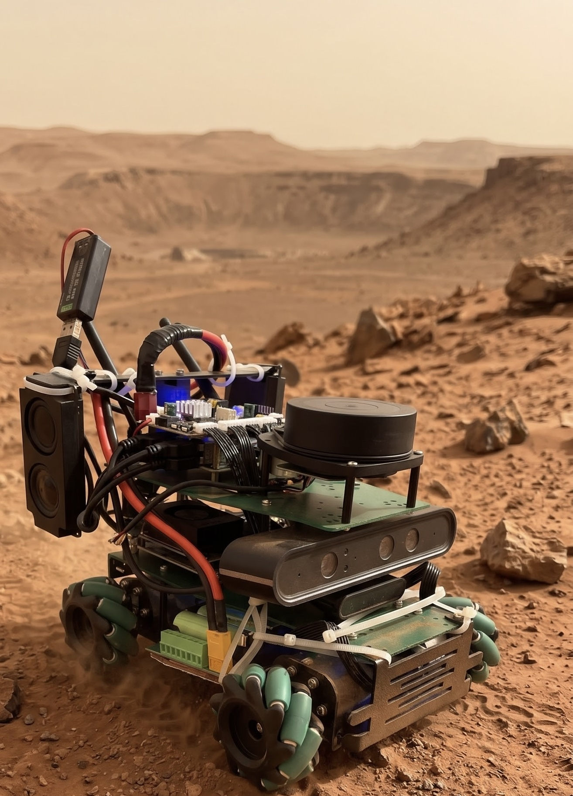

# Savelij

  

Savelij is an indoor robot on a Yahboom ROSMASTER X3 mecanum chassis. A
Jetson Orin NX on the robot runs Ubuntu and ROS 2 Humble and does the
sensing, driving, and navigation. It carries a SLAMTEC RPLiDAR A1 and an
Orbbec Astra depth camera. The chassis board runs the motors, encoders, and
IMU. The robot patrols rooms on its own, looks for cats, and can bark at one
when it sees it.

This repository is the robot's ROS 2 workspace,
`~/yahboomcar_ros2_ws/yahboomcar_ws/src`, copied from the Jetson. The robot
is the source of those files. This repo only receives pushes.

## Layout

    savelij/
    └── src/
        ├── images/savelij.jpg
        ├── lk_body/
        ├── cat_patrol_robot/
        ├── odom_drift_checker/
        ├── yahboomcar_bringup/
        ├── yahboomcar_base_node/
        ├── yahboomcar_description/
        ├── yahboomcar_msgs/
        └── ...                    ← the other yahboomcar_* packages,
                                      laserscan_to_point_pulisher,
                                      robot_pose_publisher_ros2, and so on

## Sync workflow

On this machine, from the repo root:

    ./sync_from_robot.sh

That copies `jetson@192.168.0.120:~/yahboomcar_ros2_ws/yahboomcar_ws/src/`
into `src/` here, commits whatever changed, and pushes branch `master` to
`git@github.com:ganapetya/savelij.git`.

It does not fetch or pull. A non-fast-forward push stops without changing
GitHub. Optional message: `./sync_from_robot.sh "why this sync"`.

`build/`, `install/`, and `log/` inside the robot `src` tree are colcon
output and are left behind. Files matched by `.gitignore` (large model
files, `src/lk_body/.env`) are copied onto this machine and are not committed.
